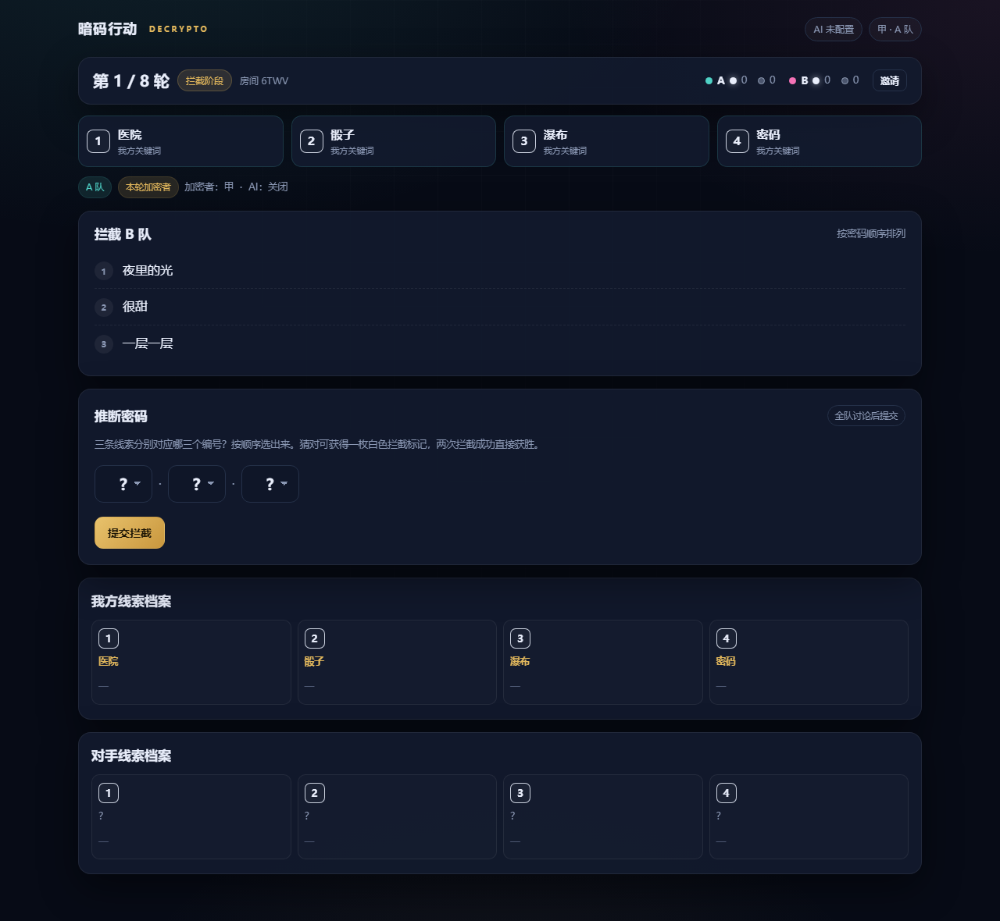
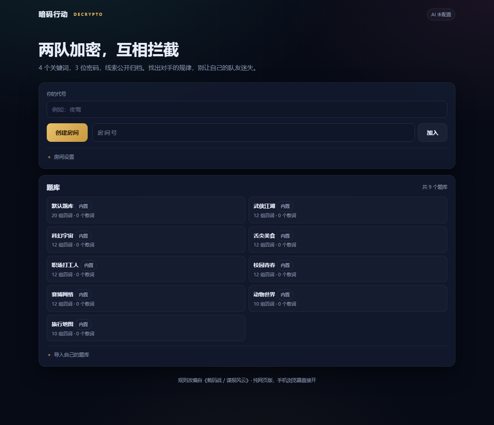

# 暗码行动 · Decrypto

网页版《截码战 / 谍报风云》（Decrypto）。两队各持有 4 个秘密关键词，通过公开线索互相拦截密码；线索按编号永久归档，对手可以据此反推你的词。

核心特性：

- **9 套内置题库**：默认 + 武侠 / 科幻 / 美食 / 职场 / 校园 / 网络 / 动物 / 旅行
- **自己导入题库**：网页上传 JSON / TXT / CSV，立刻出现在房间设置里
- **AI 补偿加密**：上一轮本队破译失败，下一轮由 AI 接管本队加密，全队一起破译
- **纯网页、无构建**：手机浏览器打开就能玩，Node 单进程部署



---

## 1. 规则速览

- 每队 4 个关键词，编号 1–4，对手看不到
- 每轮每队随机得到一个 3 位密码（1–4 中不重复的三个数字），由本队**加密者**按顺序写 3 条线索
- 线索公开。对手根据线索猜你们的密码，叫**拦截**；你们自己人要猜，叫**破译**
- 破译失败：本队 +1 黑色失误标记；被对手拦截成功：对手 +1 白色拦截标记
- **AI 补偿**：上一轮本队破译失败，下一轮就由 AI 接管本队加密（人类不参与），全队都可以破译；只补一轮
- 任意一队 **2 个白标直接获胜**；任意一队 **2 个黑标直接失败**
- 打满 8 轮按 `白标 - 黑标` 计分，同分算平局
- 线索会按关键词编号归档，所有人可见。轮次越多，对手越容易反推出你的关键词

**人数**：每队 2 人以上体验最好（最少 4 人）。每队只有 1 人也能开局，但加密者会同时参与破译，等于看过答案，仅建议用来测试流程。

---

## 2. 本地运行

需要 Node.js 20+。

```bash
cd decrypto
npm install
cp .env.example .env      # Windows: copy .env.example .env
npm start
```

打开 <http://127.0.0.1:3000>。

不配置 AI 也能玩，只是不会触发 AI 补偿，也不能用「AI 推测关键词」。

---

## 3. 配置 AI 补偿加密

任何 OpenAI Chat Completions 兼容接口都可以，默认按 DeepSeek 配置。

```bash
# .env
AI_BASE_URL=https://api.deepseek.com/v1
AI_API_KEY=sk-你的key
AI_MODEL=deepseek-chat
```

重启服务后访问 `GET /api/config`：

```json
{ "ok": true, "ai": { "configured": true, "model": "deepseek-chat" } }
```

### 三种模式（建房时选择）

| 模式 | 行为 |
|---|---|
| 补偿 `compensate`（默认） | 平时人工加密；上一轮本队破译失败后，下一轮 AI 自动接管加密，全队一起破译 |
| 全自动 `auto` | 每轮两队都由 AI 出线索，适合练习或单人测试 |
| 关闭 `off` | 纯人工，不触发补偿 |

### 补偿是怎么触发的

```text
第 N 轮：A 队破译失败，记 1 个黑标
        ↓ 结算时标记 compensation = true
第 N+1 轮：A 队 aiEncrypt = true，encoderId = 'AI'
        ├─ 人类加密者不再出现，也看不到本轮密码
        ├─ 服务端调用 AI 生成 3 条线索并自动提交
        └─ A 队所有玩家都能参与破译（AI 算加密者）
        ↓ 不论成功与否，下一轮恢复人工加密
```

- 只补偿下一轮，不会连续累积
- AI 调用失败或服务器没配 key 时，自动退回人工加密并提示，不会卡死
- 补偿轮的线索同样会按编号归档，标记为 AI

AI 生成时会自动检查：不能包含完整关键词、不能出现数字/位置提示、三条不重复、不与历史线索重复。不合规会自动重试一次，仍失败则退回人工。

### AI 推测对手关键词

对手档案右上角有「AI 推测关键词」，会把该队历史线索发给模型，返回 4 个编号的猜测和置信度。只用于辅助，不会自动提交。

> 提示词在 `lib/ai.js`，想调整风格（更抽象 / 更直白 / 英文线索）直接改 `generateClues` 里的 `basePrompt`。

---

## 4. 题库

### 内置主题题库

建房时在「题库」下拉框直接选，无需导入：

| id | 名称 | 组数 |
|---|---|---|
| `default` | 默认题库（综合） | 20 |
| `wuxia` | 武侠江湖 | 12 |
| `scifi` | 科幻宇宙 | 12 |
| `food` | 舌尖美食 | 12 |
| `workplace` | 职场打工人 | 12 |
| `campus` | 校园青春 | 12 |
| `internet` | 赛博网络 | 12 |
| `animals` | 动物世界 | 10 |
| `travel` | 旅行地图 | 10 |

合计 **9 套 / 112 组 / 448 个词**。每局从所选题库里抽两组，分别作为两队的 4 个关键词。



### 导入自己的题库

网页首页 →「题库」→「导入自己的题库」。支持三种写法：

**每行 4 个词（推荐）**

```csv
灯塔,蜂蜜,电梯,谎言
火山,邮票,镜子,马拉松
```

**每行一个词（系统随机四选一）**

```text
灯塔
蜂蜜
电梯
谎言
...
```

**JSON**

```json
{
  "name": "间谍之夜",
  "sets": [
    ["灯塔", "蜂蜜", "电梯", "谎言"],
    ["火山", "邮票", "镜子", "马拉松"]
  ],
  "words": ["苹果", "香蕉", "橘子", "葡萄"]
}
```

要求：

- 每组必须正好 4 个不重复的词
- 至少 2 组四词，或 8 个不同的词
- 只有 1 组四词时，额外再给 4 个词（第二队用）
- 上限 512KB；内置 9 套题库合计 448 个词，导入的题库会追加到列表里

题库存在 `data/packs.json`，重启不丢。删除接口默认关闭；设置 `ADMIN_TOKEN` 后可调用：

```bash
curl -X DELETE \
  -H "x-admin-token: 你的口令" \
  http://127.0.0.1:3000/api/packs/p_xxxxxxxx
```

---

## 5. 部署到 Ubuntu 云服务器（先用 IP 玩）

### 5.1 开端口

云控制台安全组放行：

- `22`（SSH）
- `80`（后面用 Nginx），或先只放行 `3000` 直连

### 5.2 传代码、装依赖

本地执行（排除依赖和本地配置）：

```bash
rsync -avz --delete ./ root@你的IP:/var/www/decrypto/ \
  --exclude node_modules --exclude .env --exclude data
```

服务器上：

```bash
ssh root@你的IP
apt update && apt install -y curl
curl -fsSL https://deb.nodesource.com/setup_20.x | bash -
apt install -y nodejs

cd /var/www/decrypto
npm ci --omit=dev
cp .env.example .env
nano .env          # 填 AI_API_KEY；暂时不填也能跑
```

### 5.3 用 pm2 守护

```bash
npm i -g pm2
pm2 start ecosystem.config.js
pm2 save
pm2 startup        # 按提示再执行它打印的那一行
pm2 logs decrypto
```

此时访问 `http://你的IP:3000` 已经能玩。要关掉 3000 对公网开放，继续配 Nginx。

### 5.4 Nginx（推荐，80 端口 + 以后挂域名）

```bash
apt install -y nginx
```

`/etc/nginx/sites-available/decrypto`：

```nginx
server {
    listen 80 default_server;
    server_name _;

    location / {
        proxy_pass http://127.0.0.1:3000;
        proxy_http_version 1.1;
        proxy_set_header Host $host;
        proxy_set_header X-Real-IP $remote_addr;
        proxy_set_header X-Forwarded-For $proxy_add_x_forwarded_for;

        # WebSocket 必须
        proxy_set_header Upgrade $http_upgrade;
        proxy_set_header Connection "upgrade";
        proxy_read_timeout 120s;
    }
}
```

```bash
ln -sf /etc/nginx/sites-available/decrypto /etc/nginx/sites-enabled/decrypto
rm -f /etc/nginx/sites-enabled/default
nginx -t && systemctl reload nginx

ufw allow OpenSSH
ufw allow 'Nginx Full'
ufw enable
```

现在访问 `http://你的IP` 即可，房间号就是邀请口令。

### 5.5 以后加域名 / HTTPS

有域名后把 `server_name _;` 改成域名，然后：

```bash
apt install -y certbot python3-certbot-nginx
certbot --nginx -d game.example.com
```

页面变成 HTTPS 后，Socket.IO 客户端会自动走 `wss://`，不用改代码。

> 国内服务器绑域名需要 ICP 备案；只用 IP 不需要。

---

## 6. 目录结构

```text
decrypto/
├─ server.js              Express + Socket.IO 入口
├─ lib/
│  ├─ room.js             纯状态机：分队、加密、拦截、破译、计分、档案
│  ├─ ai.js               AI 出线索 / 推测关键词，OpenAI 兼容接口
│  └─ packs.js            题库解析、内置题库、落盘
├─ public/
│  ├─ index.html
│  ├─ style.css
│  └─ app.js              无框架前端
├─ test/
│  ├─ room.test.js        状态机单测
│  ├─ packs.test.js       题库解析单测
│  ├─ smoke.mjs           两个真实 socket 客户端跑一轮
│  ├─ ai-smoke.mjs        假 AI 接口验证全自动加密
│  └─ ui-smoke.mjs        puppeteer 真浏览器跑完整局
├─ samples/sample-pack.csv
├─ data/packs.json        运行时生成，导入的题库
├─ .env.example
├─ ecosystem.config.js    pm2
└─ package.json
```

---

## 7. 测试

```bash
npm test                  # 28 个单测：规则、补偿、权限、信息隐藏、题库解析与内置题库
node test/smoke.mjs       # 需先 PORT=3010 node server.js
node test/ai-smoke.mjs    # 自带 mock AI，不需要真 key
node test/ui-smoke.mjs    # 真浏览器跑完整一局，需要本机 Chrome
```

- `smoke.mjs`：两个 Socket 客户端建房、加入、开局、写线索、拦截、破译、结算，验证线上状态机与信息隔离
- `ai-smoke.mjs`：起一个假的 OpenAI 兼容接口，验证 `aiMode=auto` 时会自动生成并提交线索
- `ui-smoke.mjs`：用 puppeteer-core 驱动本机 Chrome，两个标签页跑完整局并截图到 `.shots/`；Chrome 路径可用 `CHROME_PATH` 覆盖

> UI 测试依赖 devDependencies 里的 `puppeteer-core`，部署机不需要安装它。

仓库自带 GitHub Actions（`.github/workflows/test.yml`）：push / PR 时会在 Node 20 和 22 上自动跑单测、AI mock 冒烟和 Socket 联机冒烟。

---

## 8. 实现细节 / 与官方规则的差异

为了网页化，做了几处简化：

1. **双方同时提交线索、同时拦截**，而不是轮流。信息隔离由服务端保证
2. 触发 2 白 / 2 黑但双方同分时，判平局；原版会进入“猜对方四个关键词”的加赛
3. 线索“全场不得重复”只做了单轮内校验；AI 生成时会避开历史重复，人工输入不做强制
4. 服务器只把该看的信息发给该玩家：对手关键词、对手密码、未公开的线索不会出现在返回的 state 里（有单测覆盖）
5. 房间和对局在内存里，进程重启会丢；题库在磁盘上，不会丢
6. 规则依据 BGA 中文版《截码战 / 谍报风云》。你截图里“可在2上”“1可用2”“比1大”这类用编号互相提示的线索，在原版属于违规的“位置提示”，所以 AI 会自动拒绝数字和位置词。如果你玩的微信小游戏变体允许这种写法，删掉 `lib/ai.js` 里 `validateClues` 的数字/位置校验，以及 `basePrompt` 里的对应禁令即可
7. **AI 补偿是这套玩法的自定义规则**，官方 Decrypto 没有；默认开启，建房时可以切到“关闭”

---

## 9. 常见问题

**手机 4G 打不开，Wi-Fi 能开**
安全组没放行端口，或 Nginx 没 reload。

**页面能开但一直“连接断开”**
Nginx 少了 `Upgrade` / `Connection` 两行，WebSocket 被当成普通请求。

**AI 补偿不触发 / AI 报 401、400**
补偿的触发条件只有一个：**上一轮本队破译失败**。触发后下一轮加密阶段会直接显示“AI 正在为你们加密”，没有线索输入框。
报 401/400 一般是 `AI_API_KEY` 不对、没重启 pm2，或模型名不存在，看 `pm2 logs decrypto`。服务器没配 AI 时，补偿轮会自动退回人工加密并提示。
部分兼容接口不支持 `response_format`，代码会自动去掉重试一次；仍然 400 就换模型或换接口。

**AI 补偿轮为什么没有输入框**
本轮由 AI 当加密者，人类不参与写线索，密码也不会下发给任何人；等 AI 提交后，全队一起破译。生成通常需要几秒，失败会自动退回人工。

**AI 生成的线索总是不合规**
模型太弱或提示词太严。换 `deepseek-chat` / `gpt-4o-mini` 之类，或改 `lib/ai.js` 的校验规则。

**刷新后回到首页**
房间身份存在浏览器 **sessionStorage**（每个标签页独立）：刷新不会掉，关掉标签页会丢。同一个浏览器开两个标签页就是两个独立玩家，可以自己和自己测试。换浏览器/清缓存会丢，只能等下一局重新加入。

**两个人能不能玩**
可以，建房后各站一队。但每队只有 1 人时，加密者会看到密码并自己破译，等于开卷。建议至少 4 人。

**能不能接微信小游戏**
这套是纯网页。微信小游戏要求 HTTPS 域名、备案、软著和类目资质，且代码要跑在微信运行时里，不能直接复用。

---

## 10. 生产建议

- 单进程足够几十个房间；要横向扩容，把房间状态挪到 Redis，并给 Socket.IO 配 `@socket.io/redis-adapter`
- 公开部署建议加：Nginx `limit_req` 限流、`fail2ban`、定期备份 `data/packs.json`
- AI 接口按量计费，已在服务端做每玩家每分钟限次（生成 6 次 / 推测 4 次）
- 房间无人 2 小时后自动清理；`/api/health` 可用于探活

